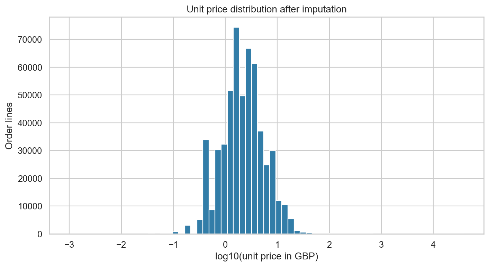
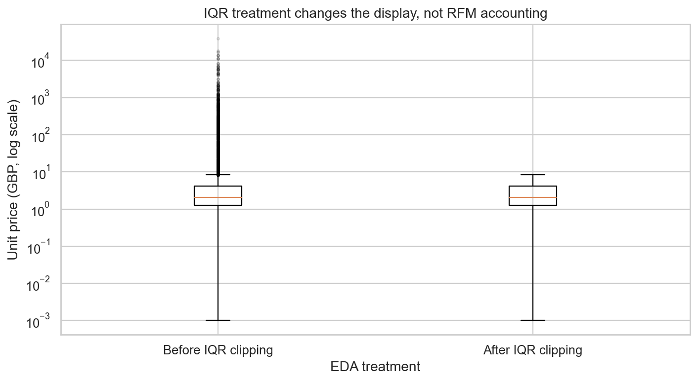
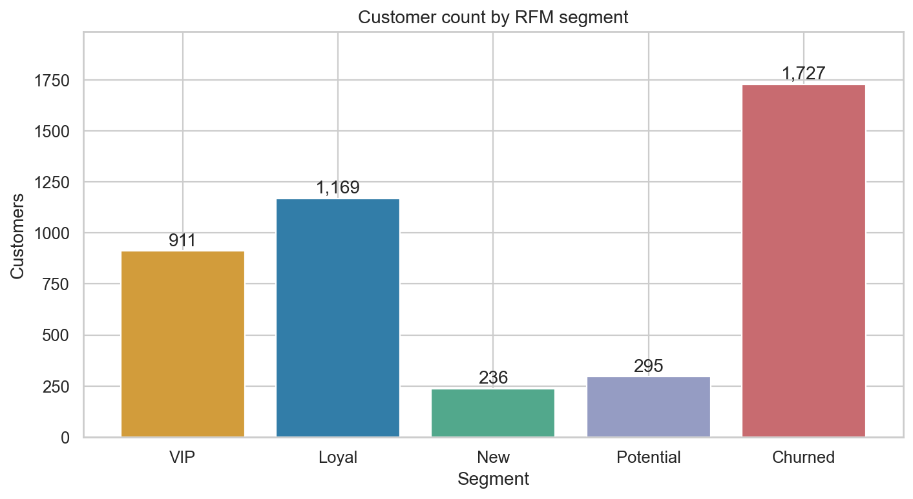
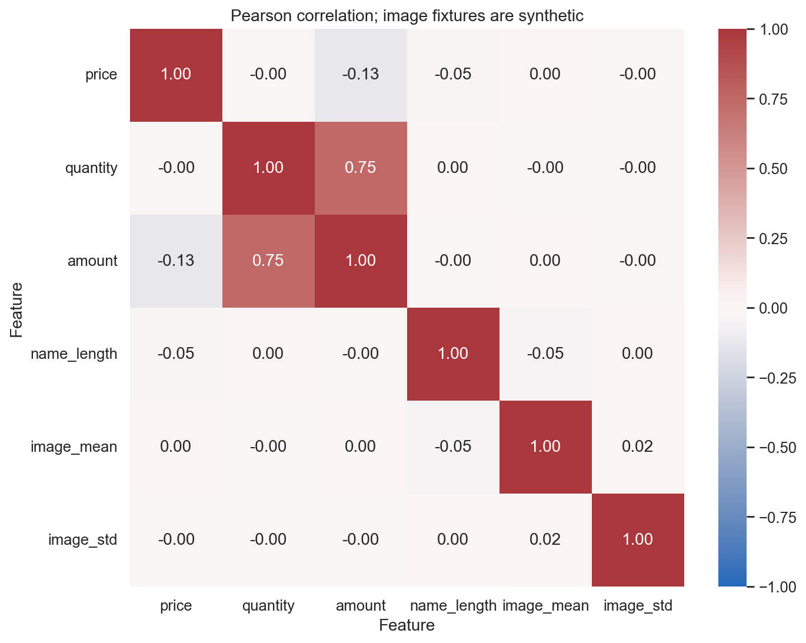
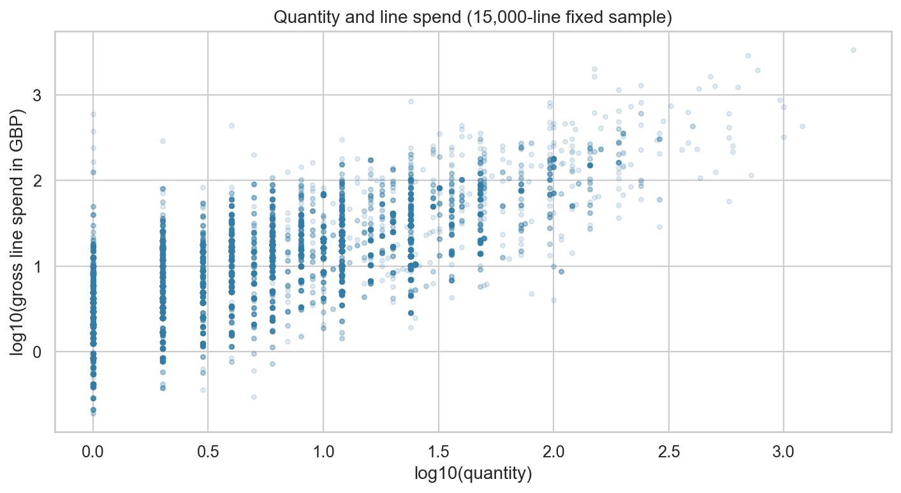
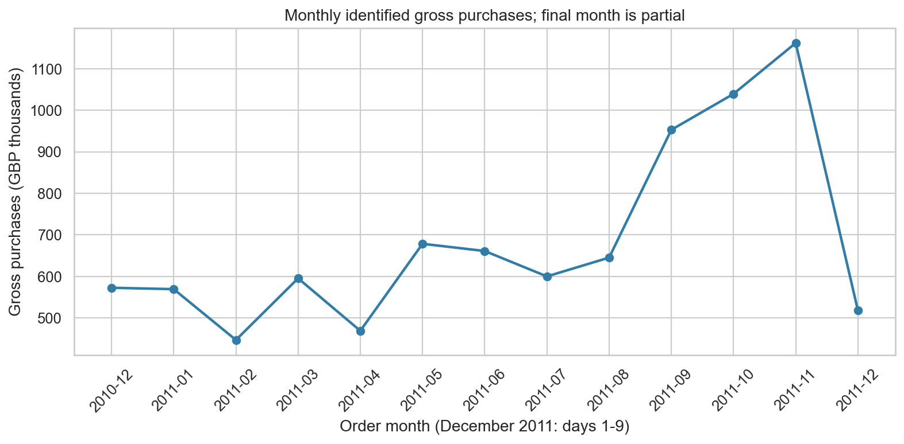

# 쇼핑몰 단골 찾기: 멀티모달 EDA와 RFM 분석

실제 거래 541,909행과 원본 8개 컬럼을 분석하는 재현 가능한 Python 프로젝트다. 전처리는 `DataAnalyzer` 클래스로 구성했고, 실행된 노트북에는 6종 시각화·수치 해석·고객 세분화를 포함했다.

## 데이터와 출처

- 거래: Chen, D. (2015), [UCI Online Retail](https://archive.ics.uci.edu/dataset/352/online+retail), [DOI: 10.24432/C5BW33](https://doi.org/10.24432/C5BW33). 라이선스 [CC BY 4.0](https://creativecommons.org/licenses/by/4.0/). 영국 온라인 소매업체의 2010-12-01~2011-12-09 자료이며 화폐는 GBP다.
- 원본 8열: `order_id`, `product_id`, `product_name`, `quantity`, `order_date`, `price`, `customer_id`, `country`. 원본 컬럼 순서와 의미를 유지하고 이름을 변경했다. 날짜는 Excel 일련번호에서 변환한다. country는 범주형이고 상품 카테고리를 뜻하지 않는다.
- **이미지는 실습용 합성 배열이다.** 원본에는 이미지가 없어 고정 seed 20261025로 상품별 16×16 RGB 배열을 생성했다. 실제 거래와 이미지가 연결된 공개 멀티모달 데이터셋은 아니다. 이미지 피처는 벡터 연산 검증용이며 시각 품질·매출의 인과관계 해석에 사용하지 않는다. 실제 상품 사진 요구가 엄격하다면 상품 ID에 연결된 정식 이미지를 추가해야 한다.
- `data/manifest.json`에 다운로드 주소·원본 ZIP 및 CSV SHA-256·합성 이미지 출처를 기록했다. 원본 데이터 전체를 사용하며 샘플링한 시계열이나 가짜 고객 데이터는 사용하지 않는다.

## 결과 요약

- 원본 541,909행 중 고객 ID 누락 135,080행. 고객 ID는 추정하지 않는다.
- RFM 유효 구매 397,884행, 고객 4,338명, 5개 세그먼트.
- 상품별 중앙값 및 전체 중앙값으로 가격 2,517행을 대치했다. 0 이하 가격은 EDA에서 결측으로 전환한다.
- 가격 IQR 이상치 39,854행. 경계 £-3.07~£8.45. 클리핑한 `price_clipped`는 시각화 전용이다.
- RFM 기준일: **2011-12-09**, 마지막 유효 거래의 달력 날짜. Recency는 일수, Frequency는 고유 주문 번호 수, Monetary는 원본 양수 가격×양수 수량의 합이다.
- 취소 주문(C 접두어), 수량 0 이하, 가격 0 이하/누락, 주문·상품·고객 ID 또는 날짜 누락을 RFM에서 제외한다. 원본 고객별 합계는 EDA 대치·클리핑으로 변경하지 않는다.
- Monetary와 월별 그래프는 **식별 고객의 총 구매액(gross purchases)**이며 반품 차감 순매출·이익·LTV가 아니다. 중복 의심 5,268행은 합법적인 반복 상품 행일 수도 있어 표시만 하고 유지했다.

| segment | customers | mean_recency | mean_frequency | mean_monetary | gross_purchases | customer_share_pct | spend_share_pct |
| --- | --- | --- | --- | --- | --- | --- | --- |
| Churned | 1727 | 191.6 | 1.98 | 777.43 | 1342624.23 | 39.81 | 15.07 |
| Loyal | 1169 | 32.36 | 3.52 | 1441.2 | 1684766.78 | 26.95 | 18.91 |
| New | 236 | 18.42 | 1.0 | 325.84 | 76897.84 | 5.44 | 0.86 |
| Potential | 295 | 52.46 | 1.0 | 402.42 | 118712.85 | 6.8 | 1.33 |
| VIP | 911 | 11.86 | 11.5 | 6244.13 | 5688406.2 | 21.0 | 63.83 |

## 세분화 규칙

R/F/M을 평균 동순위의 경험적 백분위로 1~5점화한다. R은 방향을 반전한다. 동점은 같은 점수를 받고, 모든 점수 구간이 동일 인원으로 채워질 필요는 없다. 다음 우선순위로 상호 배타적으로 배정한다.

1. VIP: R≥4, F≥4, M≥4
2. Churned: R≤2 (실제 이탈 확정이 아닌 상대적 미구매 장기화)
3. New: R≥4이고 관측 주문 1회
4. Loyal: 위 조건에 해당하지 않으면서 F≥3
5. Potential: 나머지

## 비즈니스 인사이트

**VIP 유지** — (근거) VIP 911명은 고객의 21.0%이지만 식별 고객 총 구매액의 63.8%를 차지한다. (실행) VIP 고객을 대상으로 우선 재입고 알림과 전담 응대 혜택을 제공하여 재구매 유지율 개선을 목표로 한다. (검증) 실제 순이익·반품·캠페인 노출 데이터가 필요하며, 무작위 대조군 대비 60일 재구매율과 공헌이익이 개선되지 않으면 전략을 기각한다.

**휴면 위험 고객 복귀** — (근거) Churned 1,727명(39.8%)의 평균 미구매 기간은 191.6일이다. (실행) Churned 중 과거 구매액이 높은 고객에게 개인화 재입고 안내를 보내고, 소규모 쿠폰 실험으로 30일 복귀율 개선을 목표로 한다. (검증) Churned는 상대적 최근성 점수에 붙인 이름이며 실제 이탈 확정이 아니다. 수신 동의·시즌성·할인 비용 데이터를 확보하고 대조군 대비 증분 이익으로 검증한다.

**첫 관측 구매 고객의 두 번째 주문** — (근거) New 236명은 관측 기간 주문이 1회이며 평균 구매액은 £325.84이다. (실행) 최근 1회 구매 고객에게 구매 7~14일 뒤 관련 상품 안내를 제공해 두 번째 주문 전환율 개선을 목표로 한다. (검증) 가입일과 관측 이전 구매 이력이 없으므로 진짜 신규 고객 여부는 알 수 없다. 추가 이력을 확인하고 캠페인 대조 실험으로 30일 두 번째 구매율을 비교한다.

위 효과는 실험 가설이며 현재 관측 데이터로 검증된 성과가 아니다. 가격·수량·금액은 기계적 관계가 있으므로 상관계수를 인과관계로 해석하지 않는다. 2011년 12월은 9일까지의 부분 월이므로 전월 대비 하락을 수요 감소로 해석하지 않는다.

## 시각화

| 유형 | 결과 | 읽는 법 |
| --- | --- | --- |
| 히스토그램 |  | log10 가격의 긴 꼬리 |
| 박스플롯 |  | IQR 처리 전후, 로그 가격 축 |
| 막대그래프 |  | RFM 그룹별 고객 수 |
| 히트맵 |  | Pearson 상관, 합성 이미지 포함 |
| 산점도 |  | 고정 15,000행 표본, log10 수량·금액 |
| 라인차트 |  | 고객 식별 가능한 총 구매액의 월별 추이 |

## 실행 방법

Python 3.10 이상 권장(검증: 3.12). 분석에 직접 사용하는 외부 라이브러리는 NumPy, Pandas, Matplotlib, Seaborn뿐이다. 이미지 처리는 전부 NumPy로 구현했다. Matplotlib이 간접 의존하는 Pillow는 프로젝트 코드에서 호출하지 않는다. XLSX 변환은 표준 라이브러리 zipfile/XML을 사용해 openpyxl이 필요 없다. Jupyter 패키지는 노트북 실행 도구다.

```powershell
py -3.12 -m venv .venv
.venv\Scripts\python.exe -m pip install -r requirements-dev.txt
# CSV와 이미지 배열이 이미 포함되어 있어 다운로드 없이 분석 가능
.venv\Scripts\python.exe scripts/build_report.py --execute
.venv\Scripts\python.exe -m unittest discover -s tests -v
```

원본부터 다시 준비하려면 `.venv\Scripts\python.exe scripts/prepare_data.py`를 먼저 실행한다(원본 ZIP이 없으면 약 24MB를 다운로드). Linux/macOS는 가상환경 Python 경로를 `.venv/bin/python`으로 바꾼다. `--execute` 없이 실행하면 차트·CSV·README와 실행 전 노트북을 재생성한다. 실행 결과가 포함된 노트북은 `--execute`로 만든다. VS Code에서 `.venv` 커널로 `notebooks/analysis_report.ipynb`를 열어 직접 실행해도 된다.

## 파일 구조와 검증

- `src/pipeline.py`: 로드·그룹 대치·벡터 이미지/텍스트 피처·수동 IQR·RFM·요약 통계
- `notebooks/analysis_report.ipynb`: 한국어 해석, 코드, 출력과 6종 차트
- `scripts/prepare_data.py`: 원본 출처를 보존한 CSV 변환·합성 이미지 생성
- `scripts/build_report.py`: 차트·보고서·수치 근거의 일괄 재생성
- `outputs/`: 고객별 RFM, 세그먼트 요약, 기술 통계, 상관행렬, 품질 감사 JSON
- `tests/test_pipeline.py`: 주문 중복 집계·반품 제외·원본 금액 보존·결측 대치·이미지 연산·동점·경계값 검증

추가 이미지 피처로 NumPy 인접 픽셀 차이 기반 `image_edge`도 구현했다. 코호트·Plotly 보너스는 범위에 포함하지 않았다. 고객 연락처·가입일·마진 정보가 없어 실제 발송 또는 LTV 분석은 수행하지 않는다.

## GitHub 제출

제출 저장소: [00skgun/codessey_advance](https://github.com/00skgun/codessey_advance). 이 분석은 저장소의 `1-1/`에 있다. 실행 명령은 `1-1` 폴더를 기준으로 한다. `.venv`, 임시 파일, 다운로드 ZIP은 `.gitignore`로 제외되며 재현에 필요한 CSV·NPZ·실행된 노트북·차트는 포함한다.

## 실행 증거와 평가 항목 안내

- [실행된 노트북](notebooks/analysis_report.ipynb): 모든 코드 셀의 실행 번호와 6개 PNG 출력을 저장한다.
- [전체 실행 로그](outputs/execution.log), [실행 상태·버전·SHA-256](outputs/execution_summary.json): 성공 여부와 실제 실행 셀 수·오류 수를 확인한다.
- [차트 6종](outputs/figures), [차트 제목·축 레이블·파일 체크섬](outputs/figure_manifest.json): 파일이 실제 존재하는지 추적할 수 있다.
- [19개 평가 항목 대응표](outputs/evaluation_evidence.md): 요구 사항과 검토할 파일을 한곳에 모았다.
- 원본 정규화 후 타입 분포: `string` 5열, `int64` 1열, `datetime64[ns]` 1열, `float64` 1열. 원본 8열에서 날짜·숫자·문자/범주를 다루고 별도 배열 이미지 피처를 결합한다.

## 핵심 메서드와 설정

| 메서드 | 책임 | 원본 회계 데이터 변경 |
| --- | --- | --- |
| `load_data()` | 8열 검증·숫자/날짜 변환·원본/EDA 분리 | 로드 시 원본 사본 생성 |
| `handle_missing()` | 평가 기준 호환 진입점; 아래 메서드에 위임 | 없음 |
| `handle_missing_values()` | 그룹 통계 대치·전체 폴백·그룹별 결측 감사 | 없음 |
| `image_features()` / `engineer_features()` | 벡터 이미지 통계·텍스트 길이/단어 수 | 없음 |
| `detect_outliers()` | IQR 플래그·별도 클리핑 열 | 없음 |
| `calculate_rfm()` | 식별 가능한 원본 양수 구매의 고객별 RFM | 없음 |

파라미터는 [config.json](config.json)에 모았다. `--config path/to/override.json`으로 대치 전략/그룹, IQR 배수, RFM 기준일, 산점도 표본·seed와 벤치마크 크기를 변경할 수 있다. 메서드 인자로 직접 전달하는 방식도 유지한다. `outputs/config_used.json`은 이번 실행의 실제 설정이다.

## 상관계수 2쌍 이상과 기술 통계 해석

분석 범위는 **대치 후 전체 상품 행(반품 포함)**이며 클리핑 전 `price`, `quantity`, `amount`다. [상관계수 직접 계산 결과](outputs/correlation_pairs.csv)에서 각 쌍의 표본 수와 값을 확인할 수 있다.

| 변수 쌍 | Pearson r | 해석과 시사점 |
| --- | --- | --- |
| quantity / amount | 0.746752 | 금액=가격×수량의 기계적 관계와 대량 주문이 영향을 준다. 수량과 금액을 서로 독립적인 수요 근거로 중복 계산하지 않는다. |
| price / quantity | -0.001282 | 전체 행에서 선형 관계가 약해도 개별 상품의 가격 탄력성이 없다는 뜻은 아니다. 상품·기간·반품 여부를 통제한 분석이 필요하다. |
| price / amount | -0.131163 | 음수 반품과 고가 행의 영향이 섞인다. 거래 부호를 나눈 민감도 분석 없이 가격의 매출 효과로 해석하지 않는다. |

가격 평균 £4.7113, 중앙값 £2.0800, 표준편차 £96.7579, Q1 £1.25, Q3 £4.13다. 오른쪽 꼬리에 민감한 평균·표준편차와 함께 중앙값·사분위수를 제시해야 대표 가격을 과장하지 않는다. [전체 기술 통계](outputs/descriptive_statistics.csv)에는 수량·금액·텍스트·이미지 통계도 포함한다.

## 그룹별 결측 대치의 근거와 위험

대상 가격 결측/비양수는 2,517행(0.464%)이다. 총 4,070개 상품 그룹 중 1,420개에서 대치가 필요했다. 그룹 내 관측 가격으로 2,383행을 채우고, 가격 전체가 결측인 132개 그룹의 134행은 전체 median £2.0800로 대치했다. 상품 `23595`의 결측률은 100.0%(2/2행)다. [상품별 결측률·관측 수·대치값](outputs/imputation_by_product.csv)에 전체 그룹을 기록한다.

상품마다 가격대가 달라 동일 상품 통계가 전체 통계보다 자연스러운 기준이다. 기본 중앙값은 비싼 꼬리값의 영향을 줄이지만 **결측이 무작위라는 사실을 보장하지 않는다.** 예를 들어 가격 10·20에서 결측을 15로 채우면 모집단 분산이 25에서 16.67로 줄어든다(설명용 예시). 그룹 내 분산이 줄어 그룹 간 차이가 상대적으로 과장되고, 할인 기간에만 가격이 누락되었다면 해당 그룹 가격을 과대 추정할 수 있다. 전체 폴백은 희소·신규 상품의 특성을 지울 수도 있다.

실제 관측 가격만의 모집단 분산은 8951.9291, 대치 후 전체 분산은 9362.0675다. 두 모집단의 구성·크기가 다르므로 이 차이를 대치의 인과 효과로 해석하지 않는다. 관측/대치 여부 플래그를 보존하고 상품별 결측률·유효 표본 수에 따라 민감도 분석하며, 학습으로 확장할 때는 **훈련 구간에서만** 대치 통계를 추정한다. RFM에는 대치 금액을 사용하지 않는다.

피처 결측 정책: 상품명은 같은 상품의 관측 문자열→UNKNOWN PRODUCT, 이미지 누락·NaN/무한대·[0,255] 밖 값은 오류로 중단한다. 이미지 극단값 0/255는 유효한 픽셀로 유지한다. 텍스트 길이·이미지 피처를 임의 클리핑하지 않고, 가격 극단값은 별도 플래그와 시각화용 열로 구분한다.

## IQR의 강건성과 비대칭 분포 한계

평균±표준편차 기준은 극단값 때문에 평균과 경계가 함께 움직일 수 있다. IQR은 중앙 50%의 사분위수를 써 이에 덜 민감하고 정규성 가정 없이 탐색할 수 있다. 다만 정규분포에서도 이상치 확정 검정이 아니다. 표준정규분포에 현재 1.5×IQR 규칙을 적용하면 이론 경계는 약 ±2.698σ이고 정상 관측값 약 0.698%가 경계 밖에 놓인다(표준정규 CDF로 계산한 양측 이론값).

현재 가격의 경계는 £-3.07~£8.45이고 39,854행(7.35%)이 표시된다. 오른쪽으로 치우친 양수 가격에서 음수 하한은 실용성이 낮고 상한은 정상 고가 상품까지 과도하게 표시할 수 있다. 따라서 오류라고 단정하거나 삭제하지 않는다. 상품군별 IQR·log 가격·강건 통계 및 실제 업무 기준을 함께 검토하고, IQR=0인 그룹에서는 사분위수 밖 값이 모두 표시될 수 있음도 확인한다. [NIST의 IQR 경계 설명](https://itl.nist.gov/div898/handbook/eda/section3/boxplot.htm)과 [비대칭 분포의 과다 탐지 한계](https://itl.nist.gov/div898/software/dataplot/refman1/auxillar/boxplot.htm)를 참고했다.

클리핑 전후 평균은 £4.7113→£2.9700, 표준편차는 £96.7579→£2.4038다. 분산 감소는 클리핑의 기계적 결과이며 분석 정확도 개선을 증명하지 않는다. 원본 가격·RFM Monetary는 보존한다.

## NumPy 속도 원리·벤치마크·대규모 병목

`np.ascontiguousarray(..., dtype=np.float32)`로 C 연속 메모리와 일관된 strides를 확보하고 축 (1,2,3)을 한 번에 축약한다. Python이 이미지/픽셀마다 함수를 호출하는 비용을 줄이고 컴파일된 내부 루프가 연속 메모리에 접근해 캐시 지역성을 높일 수 있다. NumPy는 CPU·빌드·연산 종류에 따라 SIMD 커널을 런타임 선택한다. 모든 mean/std가 SIMD로 실행되거나 자동 멀티코어가 된다고 보장하지 않는다. [NumPy 1.26 CPU/SIMD 문서](https://numpy.org/doc/1.26/reference/simd/index.html).

이번 환경의 동일 float32 평균/표준편차 연산(1,024개 이미지, 5회 중앙값)은 벡터 2.740ms, 이미지별 Python 루프 34.967ms, 비율 12.76배다. 최대 출력 차이는 0.00000000다. [실측 조건·각 반복 시간](outputs/vectorization_benchmark.json)을 저장했다. 이는 I/O·형변환·엣지·DataFrame 결합을 제외한 특정 환경 측정값으로 성능 보장이 아니다. 비교용 루프는 `scripts/benchmark_vectorization.py`에만 있으며 실제 `image_features()`에는 이미지/픽셀 반복문이 없다.

현재 4,070×16×16×3 uint8 배열 자체는 약 2.98MiB이고 float32 변환본은 약 11.92MiB다(임시 배열·DataFrame 제외 추정). 실제 단계별 시간은 [quality_audit.json](outputs/quality_audit.json)의 `stage_seconds`에 기록했다. 이번 측정에서 가장 오래 걸린 분석 단계는 `group_imputation`(1.375초)다. 단계별 경과 시간만으로 CPU와 I/O를 분리해 확정할 수는 없다. 규모가 커지면 CSV 문자열 파싱·원본 사본·GroupBy/Join과 이미지 압축 해제·float32 사본·std/np.diff 임시 배열이 각각 I/O·메모리 대역폭·RAM 병목 후보가 된다. 현재 크기에서는 무조건적인 병렬화보다 실측이 우선이다.

개선안: 상품당 피처를 한 번만 계산하고 ID로 결합한다. 224×224 RGB 이미지는 64개 배치의 float32 입력만 약 36.75MiB이므로 임시 배열까지 고려해 배치 크기를 제한한다. 대량 이미지 파일 읽기는 작업자 수를 제한한 I/O 스레드와 배치 프리패치를 검토하고, CPU 병렬화는 작업자별 메모리 복제·스레드 과다 경쟁을 측정해 적용한다. 압축 NPZ 대신 비압축 NPY+`mmap_mode='r'`로 필요한 배치를 읽을 수 있다. 시각화는 기간·국가별 층화 표본을 검토하되 RFM 합계와 고객 수에는 전체 거래를 사용한다. 현재 실행은 전체 이미지 벡터 연산이며 배치/병렬 확장은 제안 단계다.

## 세그먼트 실험 KPI와 점수 컷오프

1~5점은 서로 다른 R/F/M 단위를 비교하기 쉬운 초기 5분위 운영 규칙이다. VIP≥4는 각 지표의 상대적 상위 약 40%를 교집합으로 좁히려는 출발점이며, 동점 때문에 정확히 40%는 아니다. 최적 이탈 임계값으로 검증된 것이 아니므로 시즌성·마진·캠페인 수용 능력과 실험 결과로 재조정한다.

| 대상 | 제안 실험·관측 기간 | 1차 지표 | 제안 최소 개선 목표 |
| --- | --- | --- | --- |
| VIP (우선) | 무작위 혜택/대조군, 60일 | 1회 이상 재구매한 고객 수 / 배정 고객 수 | 대조군 대비 +3%p |
| Churned | 재입고 안내/대조군, 30일 | 복귀 고객 수 / 배정 고객 수 | +2%p |
| New | 관련 상품 안내/대조군, 30일 | 두 번째 주문 고객 수 / 배정 고객 수 | +5%p |
| Loyal | 상품 추천/대조군, 30일 | 재구매 고객 수 / 배정 고객 수 | +2%p |
| Potential | 소규모 추천 실험, 30일 | 재구매 고객 수 / 배정 고객 수 | +2%p |

위 숫자는 **제안 목표**이며 현재 관측된 캠페인 효과가 아니다. 실제 기준 전환율·표본 수·검정력으로 실험 가능성을 먼저 확인하고, 공헌이익/고객이 악화되지 않는지도 함께 본다. 노출이 없어도 원래 배정한 군을 분모로 평가하며 캠페인 전후 단순 비교로 인과효과를 주장하지 않는다.

## ML 확장 예시: 향후 90일 미구매 예측

명시적 타겟은 기준일 t에 기존 구매 이력이 있는 고객의 **(t, t+90일] 내 유효 구매가 없으면 `no_purchase_90d=1`, 있으면 0**이다. 이는 관측상 미구매이지 영구 이탈 확정이 아니다. 모델을 학습하거나 예측 정확도를 산출한 프로젝트는 아니며 향후 설계 예시다.

권장 입력은 t 이전 180일 R/F/M, 평균 주문액, 최초 관측 구매 이후 일수, 고유 상품 수, 고객별 구매 상품명 길이/단어 수의 평균, 국가 등이다. 실제 상품 사진을 확보한 후에만 구매 이력으로 집계한 이미지 평균·표준편차·엣지를 후보로 삼는다. **현재 합성 이미지 피처와 원시 customer_id는 입력에서 제외**한다. 행별 `amount`는 과거 합계/평균으로 고객 단위에 맞춰 집계한다.

마지막 관측일이 2011-12-09이므로 t+90일이 이 날짜 이내인 고객/기준일만 정답을 만들 수 있다. 최신 RFM 스냅샷에 미래 정답을 억지로 붙이거나 관측 종료까지 미구매한 고객 전부를 1로 두면 안 된다. 실제 후속 구매로 정답을 만들고 시간순 훈련/검증 분리, 훈련 데이터만의 대치·스케일 추정, 고객/기간 중복으로 인한 누출을 통제한다. 현재 RFM 세그먼트를 정답으로 두고 동일 RFM을 입력하면 규칙 복제에 그치므로 별도 미래 타겟을 쓴다.
